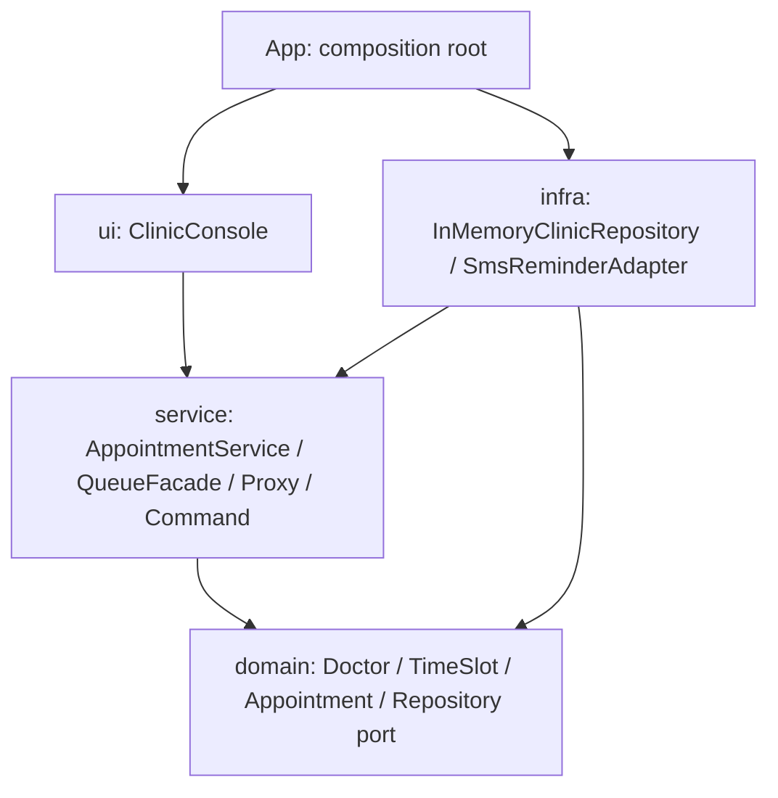
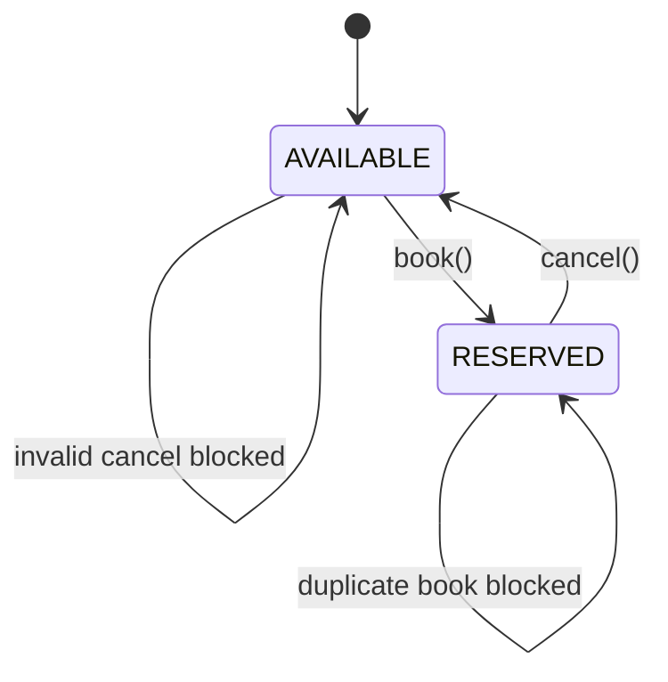

# Емхана: қабылдауға жазылу және кезек

**Capstone Project (Design Patterns)** · **Әлішер және Жұлдызхан** · 1–11 апта, M1–M3 · `v0.3`

Бұл бастапқы **Capstone_Starter_Repo.zip** шаблонындағы Java 17 + Maven жоба. Мақсат: дәрігерлер, слоттар, жазылу, бас тарту/Undo, еске салғыштар, кезек және рөл бойынша қолжетімділік.

## Visual Studio Code-та іске қосу

1. ZIP-ті ашып, ішіндегі **`is-patterns-capstone`** қалтасын **File → Open Folder** арқылы таңдаңыз.
2. **JDK 17+**, **Maven**, **Extension Pack for Java** орнатыңыз.
3. Терминалда: `mvn clean verify` (JUnit + ArchUnit + JaCoCo).
4. `App.java` ішінде **Run Java** басыңыз немесе терминалда мына командаларды қолданыңыз:

```powershell
mvn -q -DskipTests package
java -cp target/classes kz.kaznaru.capstone.App
```

Интерактивті консоль мәзірі:

```powershell
java -cp target/classes kz.kaznaru.capstone.App --menu
```

Maven қолжетімсіз болса, Java 17 арқылы:

```powershell
New-Item -ItemType Directory -Force out | Out-Null
$files = Get-ChildItem -Recurse src/main/java -Filter *.java | ForEach-Object FullName
javac -encoding UTF-8 -d out $files
java -cp out kz.kaznaru.capstone.App
```

## Құрылым





## UML және архитектура сызбалары

- [Архитектура PNG](docs/diagrams/architecture.png)
- [11 паттерн UML байланыстары PNG](docs/diagrams/patterns.png)

## Паттерндер

11 қолданылған үлгі және тесттері: [PATTERN_REGISTER](docs/PATTERN_REGISTER.md). Ұсынылған тақырыптағы **Command, Chain, Observer, Proxy** түгел енгізілген. M3 үшін **State, Strategy, Builder, Facade**, сондай-ақ M2 үшін **Factory Method, Adapter, Iterator** бар. Observer+Adapter және Facade+Strategy+Iterator+Factory үйлесімі бар.

**Кеңейту нүктесі:** `ByPatientQueueStrategy` және `BySlotQueueStrategy`; үшінші стратегияны интерфейсті іске асыратын жаңа класс түрінде қосуға болады.

## M1–M3 құжаттамасы

- [10 user stories](docs/USER_STORIES.md)
- [Кезеңдер](docs/MILESTONES.md)
- [PATTERN_REGISTER](docs/PATTERN_REGISTER.md)
- [ADR](docs/adr)
- [Топ мүшелерінің рефлексия файлдары](docs)
- CI: `.github/workflows/ci.yml`

## GitHub-қа салу

Әлішер мен Жұлдызхан жеке репозиторийде GitHub Actions, branch protection, issue, branch, review және PR-лерді өз аккаунттарымен жүргізеді. M1–M3 үшін v0.1, v0.2, v0.3 тегтері және жасыл CI қажет. Жоба ZIP файлында GitHub-та орындалғанын дәлелдейтін тарих жоқ. `bash scripts/check-deliverables.sh` тексеруі тегтер жасалғанға дейін сәтсіз болады — бұл күтілетін жағдай.

## Ескерту

Бұл студенттік демонстрациялық жүйе. Клиникалық деректер мен нақты пациенттердің жеке ақпаратын қолданбаңыз: деректер in-memory, SMS — желісіз mock gateway. Бұл өндірістік медициналық жүйе емес.
